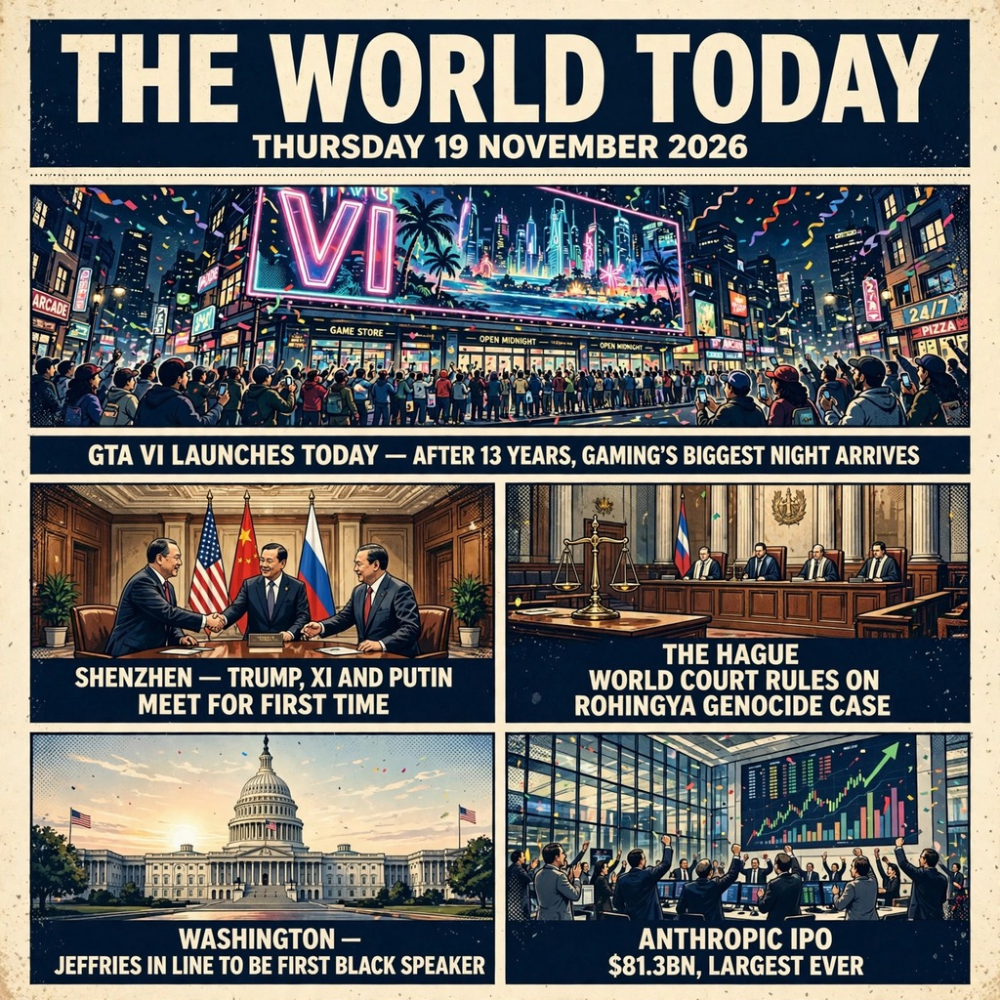

# The World Today — Thursday 19 November 2026

[](https://make.fun/bounty/news-image-20261119)
[](https://make.fun/bounty/news-image-20261119)
[](https://make.fun/bounty/news-image-20261119)

One picture that sums up Thursday 19 November 2026: a vintage newspaper
front page, drawn as an illustrated broadsheet, carrying the five stories
that defined the day.

This is my entry for the [make.fun bounty "Sum up 19 November's world news
in one image"](https://make.fun/bounty/news-image-20261119)
(`news-image-20261119`).



## The five stories on the page

1. **GTA VI launches today.** Rockstar's Grand Theft Auto VI goes on sale
   for PS5 and Xbox Series X|S, rolling out at midnight local time starting
   in New Zealand — the first new mainline GTA in 13 years. Standard
   edition $79.99. Reviews landed on 18 November to near-universal praise
   (Metacritic 99).
2. **Trump, Xi and Putin meet in Shenzhen.** The first-ever meeting of the
   three leaders, held on the APEC sidelines, with Iran and nuclear-arms
   cuts on the agenda. Both the White House and Beijing confirmed the
   meeting; officials say no agreement is expected.
3. **World court delivers its Rohingya verdict today.** The International
   Court of Justice hands down its judgment in The Gambia v. Myanmar,
   on whether Myanmar's military committed genocide against the Rohingya
   in 2017, when more than 730,000 people fled to Bangladesh. The reading
   starts at 08:00 GMT.
4. **Jeffries in line to be first Black Speaker.** House Democrats
   nominated Hakeem Jeffries as their Speaker candidate in a 251–11
   closed-door vote on 18 November. If the full House elects him on
   3 January, he would be the first Black Speaker in US history.
5. **Anthropic IPO — $81.3bn, the largest ever.** Anthropic priced its
   shares at $83, raising $81.3bn and topping SpaceX as the biggest IPO
   on record, at a valuation of about $1.5tn fully diluted. Shares start
   trading on Nasdaq under the ticker ANT today.

Every fact above was checked against a real published source on the
morning of 19 November 2026 (Reuters, AP, Al Jazeera, BBC). Nothing on
the page is invented, and no outcome is claimed for the court judgment,
which had not yet been delivered when the image was drawn.

## How the entry works

The front page is a single pre-rendered image, `entry.png` (1024×1024
JPEG, under 1 MiB). The program does not draw anything at run time: it
simply places the finished picture where the harness expects it.

`main.py` (Python 3.13, standard library only) reads `entry.png` from
the same folder as the script and copies it byte-for-byte to
`entry.png` inside the output directory given by `MAKEFUN_OUTPUT_DIR`
(default `/output`). The copy is deterministic — the same input bytes
always produce the same output bytes — and it makes no network calls.

## Run it locally

```sh
mkdir -p out
MAKEFUN_OUTPUT_DIR=out python3 main.py
```

Afterwards `out/entry.png` is an exact copy of `entry.png` in this
repository. Run it twice into two different folders and the two
outputs are byte-identical (same SHA-256).

## License

MIT — see [LICENSE](LICENSE).
